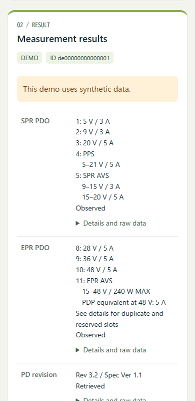

# KM003C PD Interrogator

English · [日本語](README.ja.md)

Capture USB Power Delivery data from a ChargerLAB POWER-Z KM003C, then scan the meter's QR codes with your phone. Explore SPR/EPR PDOs, PPS status, source identification and cable e-marker data. Save or share the original bytes and decoded results as JSON.

**[Open the QR importer](https://inuchanbt.github.io/km003c-pd-interrogator/)** · **[Install on a KM003C](docs/INSTALL.md)** · **[Windows downloads](https://github.com/inuchanbt/km003c-pd-interrogator/releases)**

## Try it on your phone

Open the importer and choose a power source, cable, or PPS example under **Try without a device**. You can view details and save JSON without hardware, a GitHub account, or a Python install. Choose **日本語** to switch the interface.

The built-in samples display **DEMO** and stay out of import history. Saved and shared demo JSON includes `"synthetic": true` and a `sample_type` of `source`, `cable`, or `pps`. Imported QR data with `origin: "demo"` also gets the synthetic flag. Measurement exports retain their original origin and fields.



## Install on a meter

The experimental overlay targets **KM003C HW 2.3 with the exact supported stock 2.0.7 application and bootloader**. The version label alone is insufficient. The Windows tools check the hashes and require a verified backup from your own unit. Installation, startup, and full restoration were tested on one unit. See the [installation and recovery guide](docs/INSTALL.md) and [hardware test record](docs/HARDWARE-2026-11-05.md).

## Measure and scan

- **Power source.** Disconnect downstream equipment, connect the source, and run the stock PD detection. Hold Left and Right for about one second to open the result. The overlay waits for applicable SPR/EPR negotiation and follow-up queries.
- **Cable.** Run the stock **USB-C eMarker** test with the cable under test. Hold Left and Right on the result screen to open the cable QR pages.
- **PPS.** In **Charging protocol**, set the PD mode beside **Be ready!** to **PD3.0 (SPR)** when using an EPR-capable source. Use the stock **Power Delivery** trigger to establish a PPS contract. Once the output follows the setpoint, hold Left and Right on the adjustment screen. The result shows the request and the source's PPS Status reply.
- **Phone.** Scan each page with the iPhone Camera app and open its link. Pages may be scanned in any order. Left and Right change pages on the meter. Exit returns to the stock screen. The importer also accepts images and pasted KPD1 text.

A cable result marked **Recorded with e-marker emulation enabled** records the meter's setting. With this setting enabled, the physical source of each VDO is uncertain.

The importer decodes the URL fragment locally and stores up to 10 partial or complete transfers on the same browser origin. Reopen a history entry to decode its original QR pages with the current importer. History is shared between the English and Japanese views. Save important results as JSON before clearing browser data or closing a private session. The meter retains its latest result in RAM until it restarts. See [capture and storage behavior](docs/NATIVE-CAPTURE-207.md) and [source queries and PPS operation](docs/NATIVE-INFO-207.md).

## Host CLI

The Python CLI supports demos, CH32H417 log import, KM003C capture and replay, and QR import/export. Install Python 3.10 or later. The Windows release's offline preparation step uses Python 3.12 or later.

```powershell
python -m venv .venv
.\.venv\Scripts\python.exe -m pip install -r requirements.txt
.\pdinfo.ps1 demo --output artifacts/demo-new --qr
.\pdinfo.ps1 serve
```

The demo writes QR images and page text under `artifacts/demo-new/qr/`. Open the HTTPS importer from the QR URL, or paste the page text into the local importer at `http://127.0.0.1:8767/`.

```powershell
.\pdinfo.ps1 import-ch32 C:\captures\raw.log --output captures/ch32-import --qr
.\pdinfo.ps1 replay captures/charger-01/events.jsonl --output captures/replayed --qr
.\pdinfo.ps1 export-qr captures/charger-01/snapshot.json --output artifacts/qr-export
.\pdinfo.ps1 import-qr artifacts/qr-export/qr/pages.txt --output artifacts/restored
```

Live capture on stock firmware is experimental and uses a separate [KM003C CLI](https://github.com/inuchanbt/KM003C-CLI) checkout and its transport dependencies. Start with `.\pdinfo.ps1 capture --output captures/charger-01 --dry-run`. Before a live run, disconnect downstream devices and turn off any load. For the query sequence and output files, see [host capture](docs/HOST-CLI.md).

## Developer reference

- [KPD1 transfer format](docs/QR-FORMAT.md) and [USB PD decoding](docs/PDO-DECODING.md)
- [Firmware integration](docs/FIRMWARE-INTEGRATION.md), [stock layout](docs/STOCK-207.md), and [overlay build](docs/OVERLAY-207.md)
- [Native library and test commands](native/README.md) and [Windows host source build](native-host/README.md)
- [Documentation index](docs/README.md) · [Japanese documentation](README.ja.md)

GitHub Actions runs the tests and deploys the static importer from `phone/`. The Python and JavaScript decoders are tested against the same data and saved KPD1 pages.

```powershell
.\.venv\Scripts\python.exe -m unittest discover -s tests -v
```

The full suite also uses Node.js, a C11 compiler, and Unicorn. Set `KPD_CC` to the C compiler path if needed.

Project code is licensed under [MIT](LICENSE). See the [third-party notices](THIRD_PARTY_NOTICES.md) for included code and Windows distribution components.
